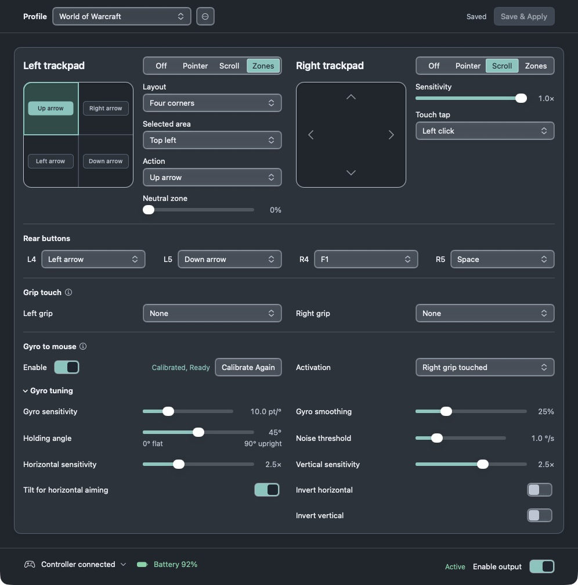

  

<h1 align="center">Paddr</h1>

<strong>Your Steam Controller 2. Your Mac. Your mappings.</strong>

Turn the trackpads into a mouse, scroll surface, or a set of keyboard shortcuts. Aim with the gyro, bind the rear buttons, and use grip touch to hold an action or activate motion aiming—all without Steam Input.

[Download Paddr](https://github.com/zachspartofaday/Paddr/releases/latest) · [Mapping guide](docs/USING.md) · [Release notes](CHANGELOG.md)

## Build a setup that feels right

Use one pad for movement and the other for scrolling, or turn either into a pointer. Both editors stay visible together, so you can shape the whole setup in one place.

- **Pointer and scroll:** tune each pad independently, including acceleration, smoothing and touch taps.
- **Button Zones:** choose from five layouts, from two large regions to a nine-button grid. Give each area its own key or mouse action.
- **Rear buttons and grip touch:** map L4, L5, R4 and R5, plus independent left and right grip-contact actions. Grips sense touch, not squeeze pressure.
- **Profiles:** save complete setups and switch from the window or menu bar. Edits stay a draft until you apply them.

## Fine aiming, with a touch

Use controller motion for mouse aiming while a grip or pad is touched, or choose Always. Bank the controller side to side for horizontal aiming, or switch to turning. Adjust horizontal and vertical response separately, compensate for your holding angle, and calibrate from a guided hold-still prompt.

The starting tuning uses 10 pt/° sensitivity, 2.5× gain on both axes and a 45° holding angle, with tilt aiming selected. Gyro starts off; enable it when you want it. A grip can activate aiming and hold a key or mouse button at the same time—for example, right-click dragging for a game's camera.

[More about gyro, calibration and grip touch →](docs/USING.md#gyro-mouse-and-grip-touch)

## At home on your Mac

A compact workspace, a live battery indicator, and tuning that opens when you need it. The window fits its contents and scrolls on smaller screens. Light mode uses blue accents; dark mode takes its teal from the Compass icon.

Paddr works with directly launched games such as **World of Warcraft**. It sends ordinary mouse, scroll and keyboard events while Apple's native controller service handles buttons, sticks and triggers. Steam, Steam Input and Steam Overlay are not required.

Game support varies, especially for captured mouse aiming and games using raw controller input. Paddr reads the puck's reports without changing controller firmware or native gamepad mappings. [Capture notes](docs/images/README.md) record their source and state.

## Install and get started

You'll need an **Apple silicon Mac running macOS 27 or later** and a **Steam Controller 2 connected through its puck**. The maintainer has confirmed released macOS 27 and macOS 27.2 release candidate. Bluetooth and direct USB remain unvalidated.

1. Download `Paddr.zip` from [Releases](https://github.com/zachspartofaday/Paddr/releases/latest), unzip it, and move `Paddr.app` to Applications.
2. Launch Paddr and grant **Input Monitoring** to read the controller and **Accessibility** to send mapped input. The guide and **Open setup** link to the relevant macOS settings.
3. Choose **Duplicate to Edit** for the built-in Default profile, configure your mappings, and choose **Save & Apply**.
4. Turn on **Enable output**, then release the pads, assigned rear buttons and assigned grips so output can activate. For gyro aiming, choose **Calibrate** and follow the hold-still prompt.

Saving does not enable output. Closing the window leaves Paddr in the menu bar; reopen the guide from Help at any time.

## Guides and development

[Mapping guide](docs/USING.md) · [CLI reference](docs/CLI.md) · [Build from source](docs/BUILDING.md) · [Contributing](CONTRIBUTING.md) · [Report a problem](https://github.com/zachspartofaday/Paddr/issues)

## License

[MIT](LICENSE), with required third-party attribution in [THIRD_PARTY_NOTICES.md](THIRD_PARTY_NOTICES.md).
