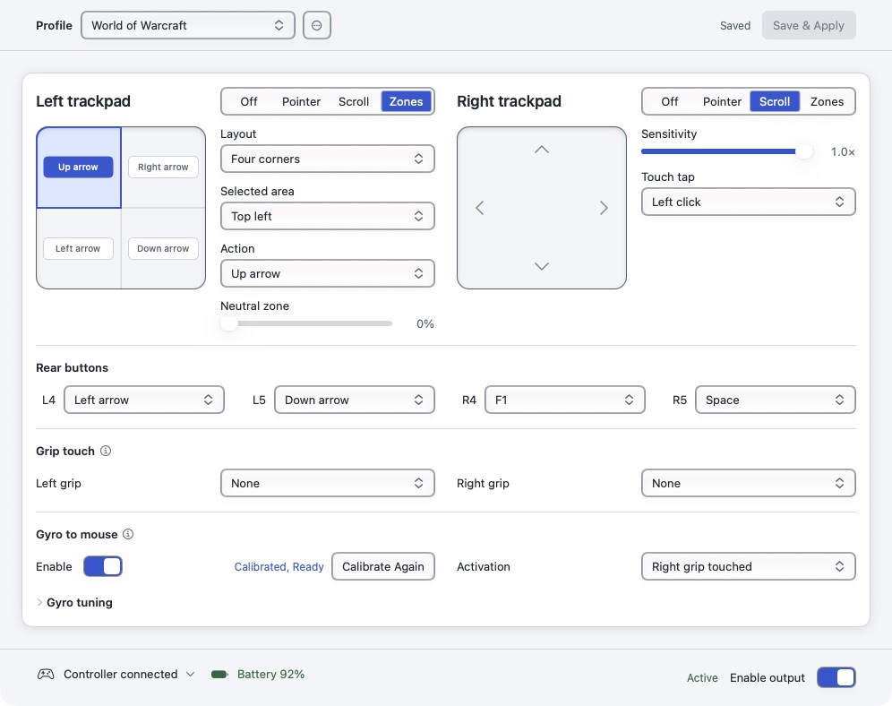
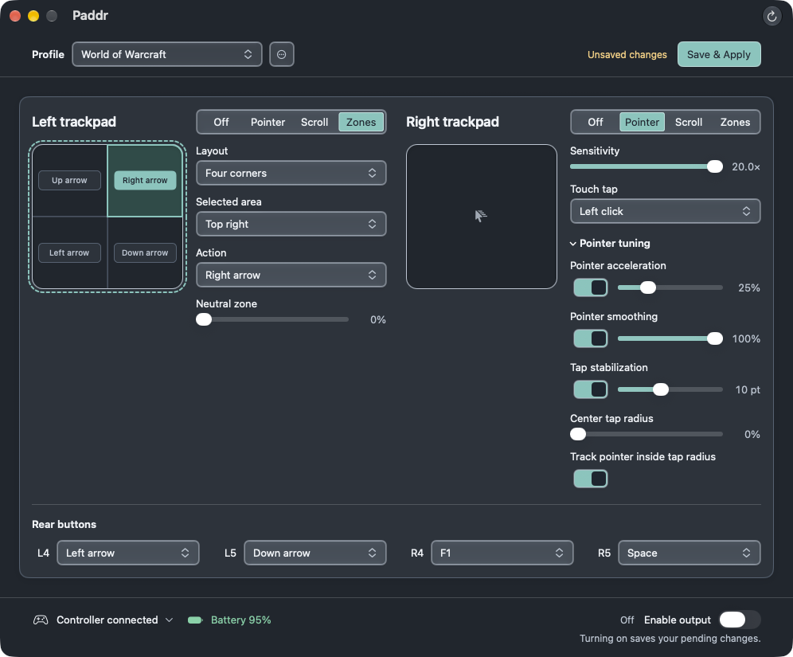
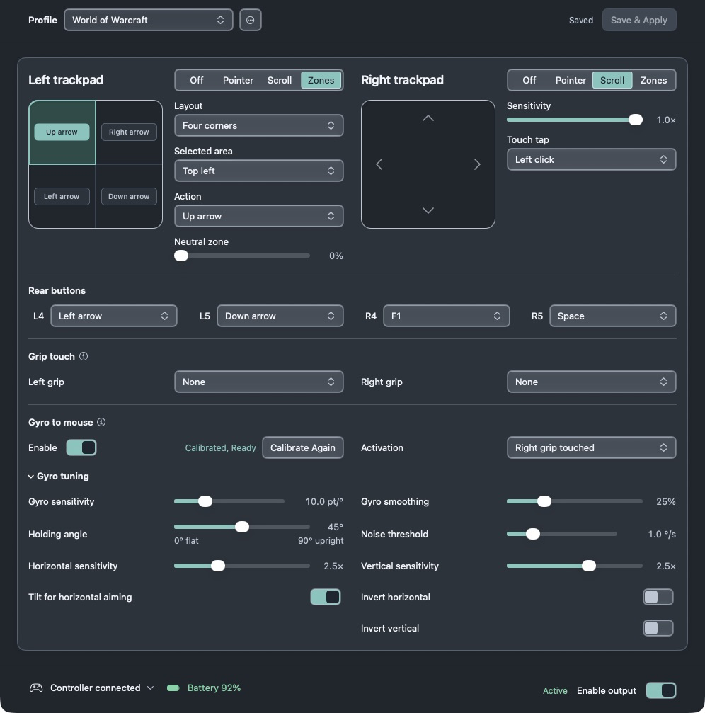

# Mapping guide

[Back to Paddr](../README.md) · [CLI and configuration reference](CLI.md)

## Setup

On first launch the configuration window opens with a setup checklist above the workspace. It lists four steps: allow access, connect the puck and controller, edit your own profile, and enable output. Completed steps are checked, and the next step offers its action in place, such as the permission buttons, **Duplicate to Edit** or **Enable Output**. Choose **Skip Setup** to hide it, or **Done** once output is active; the editing step is optional. Paddr offers the checklist automatically until you dismiss it, close the window, or reach active output. **Help > Paddr Guide**, or **Paddr Guide…** in the menu-bar menu, shows it again at any time and scrolls it into view.

## Trackpads and rear buttons

Apple's HID service continues to provide native buttons, sticks, triggers, and controller identity. Paddr passively reads the puck reports and adds:

- **Button Zones:** independently available on either or both pads, with radial four-way, four-corner, left/right, top/bottom, and 3×3 layouts and a separate keyboard key or mouse button for every region;
- pointer mode with independent sensitivity, switchable acceleration, optional adaptive smoothing, and
  tap-stabilization tuning for each pad, plus independently adjustable scroll sensitivity;
- optional **Rear buttons** mappings for L4, L5, R4, and R5, held as keyboard keys or mouse buttons until release;
- touch-taps mapped to a keyboard key, left click, or right click;
- a pointer-mode center tap radius that confines taps to the pad center while pointer tracking uses the full pad by default, with a per-pad switch for restoring the former coupled tracking dead zone; and
- named profiles for saving and quickly switching complete pad, rear-button, gyro and grip setups.

The interactive squircle map mirrors runtime hit-testing. Select a zone on the map or with the **Selected zone** pop-up, then assign its action. Radial, corner, and two-way layouts support an adjustable neutral region; the 3×3 layout dedicates the full pad to nine actions.

Paddr does not send controller feature reports or alter lizard mode, firmware, IMU, haptics, rumble, or Apple's native gamepad mappings. A bar floating over the bottom of the workspace groups permission setup with output and shows battery data when available. Click the controller status to open **Connection details**, a list of access, puck, controller, output and battery status with a **Refresh** button. When Paddr asks you to connect the puck and refresh, **Refresh** also appears beside that instruction; while Paddr is already looking for the puck it asks only to **Connect the puck**. **Enable output** controls mapped mouse, scroll, and keyboard emission. An enabled switch can still be **Waiting** for access, connection, or neutral controls. **Puck** reflects passive receiver discovery alone, while **Controller** reflects fresh reports from the controller. Device observation continues with output off.

Edits remain a draft until saved, and the window title shows **Edited** meanwhile. **Save & Apply**, in the window toolbar or with Command-S, saves the draft without turning output on. Turning **Enable output** on also saves a pending draft before activation; a visible hint explains this when edits are pending and output is off.

Disabling output or losing the controller releases held mapped keys and mouse buttons before Paddr becomes idle. Release obligations remain tracked until the matching up events succeed, and reconnect waits for both trackpads, assigned rear buttons and assigned grips to be released before safely resuming.

Rear buttons start at **None** in new profiles and profiles created before rear-button support. Assign each one in the Rear buttons group below the pads, then choose **Save & Apply**. Hold a rear button to hold its assigned action; release it to release the action. Hover over a picker for help. Draft edits do not change active output. Restore Defaults requests confirmation before replacing unsaved edits and resets rear bindings to None in the draft; save before using the changes. Unassigned rear buttons emit nothing and do not delay output activation. F1–F4 are available choices, with no automatic game-specific preset.

## Profiles

Profiles own the complete left/right configuration and keep a stable internal ID when renamed. Select a profile with the picker in the window toolbar. The profile actions menu beside it creates, duplicates, renames and deletes profiles, restores defaults, and reverts a draft; an unavailable action says why. Profile names cannot themselves be UUIDs, keeping name-or-ID selection unambiguous. Switching with unsaved edits asks before discarding them. **Revert to Saved** asks for confirmation, then discards only the unsaved draft: the saved profile and active output are unchanged. Quitting with an unsaved draft offers **Save & Quit**, **Cancel**, or **Quit Without Saving**; a failed save cancels the quit and leaves the draft available. Deleting the active user profile confirms and activates Default first.

Default is read-only. While it is selected, a notice at the top of the workspace says so and offers **Duplicate to Edit**.

Closing the configuration window leaves Paddr in the menu bar with quick actions for output and saved-profile switching. Paddr appears in the Dock and Command-Tab only while the window is open. Menu switching is unavailable while the configuration window has an unsaved draft; open the window to save or explicitly discard it. The configuration window can be moved and minimized, but Paddr controls its size and does not support full screen.

## Zone layouts

Choose **Zones** on either pad, select a layout, then click a zone on the map or use **Selected zone** to assign it. Radial four-way, four corners, left/right, top/bottom, and 3 × 3 layouts are available. Each region can hold a keyboard key or mouse button until the touch moves or lifts. Crossing regions releases the previous action before pressing the next. Non-grid layouts offer an adjustable neutral region; 3 × 3 uses the whole pad.

## Pointer tuning

Expand **Pointer tuning** on either pad to adjust acceleration, smoothing, tap stabilization and the center tap region. The info button beside the heading explains each setting. The window grows to fit, and shrinks when you close it. Turning acceleration off preserves its strength.

## Gyro mouse and grip touch

**Gyro to mouse** translates rotation into mouse movement. It starts Off when not explicitly enabled in a saved profile. Duplicate Default to edit it, enable gyro, choose **Activation**, then **Save & Apply** and enable output. Choose **Calibrate**, put the controller down on a stable surface or hold it still, then press **Calibrate** in the preparation prompt. Wait for **Calibrated, Ready**, release the activation contact, then touch that grip to aim. Use **Always** only when you want motion aiming without a touch condition. Gyro and trackpad pointer movement can be used together.

Gyro sensitivity is the shared base, measured in mouse points per degree. **Horizontal sensitivity** multiplies only left/right movement (0.1–8×, default 2.5×); **Vertical sensitivity** remains independent and multiplies only up/down movement. **Gyro tuning** provides independent horizontal and vertical scale, horizontal/vertical inversion, smoothing, a stationary-noise cutoff, **Holding angle**, and **Tilt for horizontal aiming**. Set the holding angle from 0° for a flat controller to 90° for an upright controller; it adjusts which combination of yaw and roll controls horizontal aiming. It defaults to 45° and follows the normal Save & Apply flow. Turn on **Tilt for horizontal aiming** to move the mouse left/right by banking the controller side to side rather than turning it. Forward/back tilt still controls up/down. Holding angle applies to both horizontal modes; horizontal inversion is available if you prefer the opposite direction. Tilt aiming defaults on. Explicitly saved tuning is preserved. Save & Apply the change, then calibrate the new output session.

The starting tuning is **10 pt/°**, **2.5×** horizontal and vertical sensitivity, **45°** holding angle, **25%** smoothing and a **1°/s** noise cutoff, with both inversion switches off. These defaults apply to new or missing values; saved tuning stays intact.

Calibration estimates sensor bias for the current output session; it is not saved into the game profile. The app waits for an explicit **Calibrate** action; enabling gyro or output does not start a measurement. A new output session, stale calibrated motion or a sensor-clock reset requires another calibration. An already requested measurement can restart its stationary interval if reports briefly pause. If calibration does not finish, set the controller down briefly.

The status row below the **Gyro to mouse** heading distinguishes **Save & Apply needed**, **Calibration needed**, **Calibrating**, **Calibrated, Ready**, and **Aiming**; hover the status for its current instruction. Sensitivity is inside the two-column tuning disclosure. An **Enable** label and switch start the row below the heading. The compact calibration status sits immediately before **Calibrate**; **Activation** shares that row and aligns with **Right grip**. The **Calibrate** button on that row ends on the left inspector’s right edge; it becomes **Calibrate Again** once calibrated. With output enabled and fresh motion available, choose either action to open the preparation prompt, then press **Calibrate** when the controller is still. Cancel or Escape dismisses the prompt without changing calibration. Gyro aiming pauses during this process; pad, rear-button and grip output continue without a session restart. Release and retouch the activation input after calibration. The button is unavailable while output is off, sensor data is missing or profile/session work is pending.

The circled info buttons beside **Grip touch** and **Gyro to mouse** provide explanatory help on hover or click. **Grip touch** assigns separate left and right key/mouse actions. Touch holds the action; lifting your hand releases it. This senses hand contact, not squeezing force. Contact indicators appear beside assigned grip actions, work with output off, and distinguish released contacts from missing reports. Selecting **None** hides that grip’s contact text; it can still activate gyro. A grip can both activate gyro and hold an action; choose None if it should only activate gyro. A mouse-button grip binding makes gyro movement a drag while held, including right-button camera dragging. The game decides how it uses that button and movement. Assigned grips must be released before output first arms. A grip used only for gyro activation must be released before that activation can engage, without blocking ordinary pad output.

All mapped output follows the existing Enable output switch, permissions and profile lifecycle. Disable, controller loss or expired input releases held grip actions; another pad/rear/grip holding the same action retains its ownership. Stale motion is discarded rather than integrated into a large cursor jump. Stationary readings of zero are valid sensor data.

Paddr only reads motion that the puck already supplies. It does not enable the controller's IMU or change firmware settings. If **Motion unavailable** persists, gyro cannot operate in that session; grip and pad mappings remain usable when their reports are available. Cold-start, sleep/wake and reconnect availability require physical verification. Direct USB and Bluetooth are outside this implementation.

Mouse-event support varies by game. The emitter supplies movement deltas and preserves dragging while mouse buttons are held, but captured-camera aiming, cursor recentering and screen-edge behavior need acceptance in each target game. Games that consume raw GameController/GCMouse input may bypass synthetic events entirely. This feature does not create a virtual joystick or triggers. Keyboard tilt driving remains separate future work.
