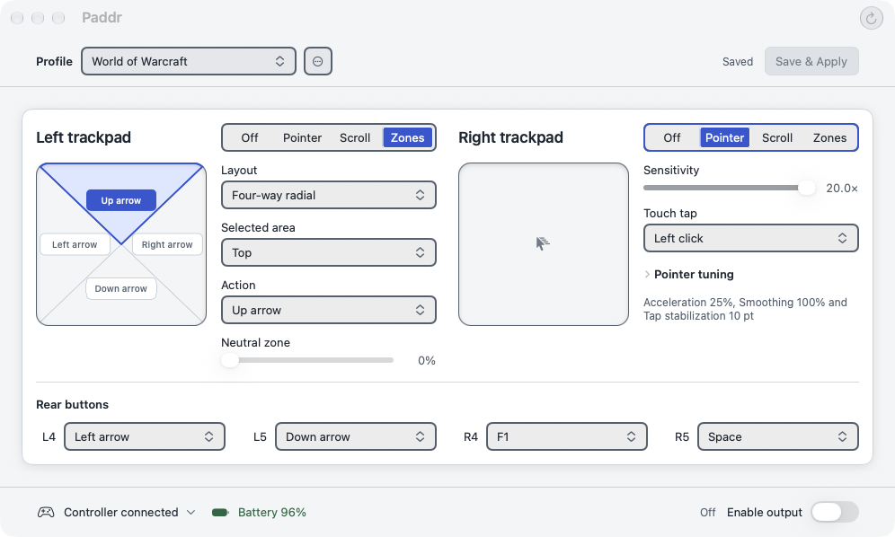
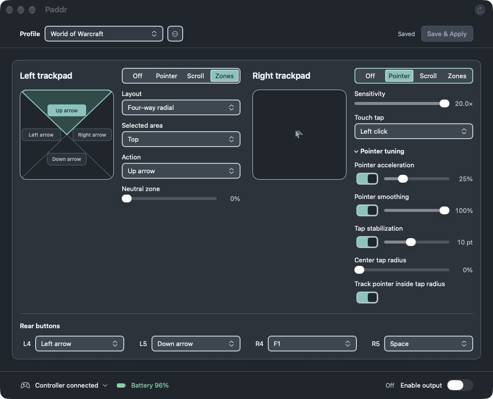

# Mapping guide

[Back to Paddr](../README.md) · [CLI and configuration reference](CLI.md)

## Trackpads and rear buttons

Apple's HID service continues to provide native buttons, sticks, triggers, and controller identity. Paddr passively reads the puck reports and adds:

- **Button Zones:** independently available on either or both pads, with radial four-way, four-corner, left/right, top/bottom, and 3×3 layouts and a separate keyboard key or mouse button for every region;
- pointer mode with independent sensitivity, switchable acceleration, optional adaptive smoothing, and
  tap-stabilization tuning for each pad, plus independently adjustable scroll sensitivity;
- optional **Rear buttons** mappings for L4, L5, R4, and R5, held as keyboard keys or mouse buttons until release;
- touch-taps mapped to a keyboard key, left click, or right click;
- a pointer-mode center tap radius that confines taps to the pad center while pointer tracking uses the full pad by default, with a per-pad switch for restoring the former coupled tracking dead zone; and
- named profiles for saving and quickly switching complete pad and rear-button setups.

The interactive squircle map mirrors runtime hit-testing. Select a region on the map or with the **Selected area** pop-up, then assign its action. Radial, corner, and two-way layouts support an adjustable neutral region; the 3×3 layout dedicates the full pad to nine actions.

Paddr does not send controller feature reports or alter lizard mode, firmware, IMU, haptics, rumble, or Apple's native gamepad mappings. The footer groups permission setup with output and shows battery data when available. Click the controller status to open **Connection details** for access, puck, and battery status. **Enable output** controls mapped mouse, scroll, and keyboard emission. An enabled switch can still be **Waiting** for access, connection, or neutral controls. **Puck** reflects passive receiver discovery alone, while **Controller** reflects fresh reports from the controller. Device observation continues with output off.

Edits remain a draft until saved. **Save & Apply** saves the draft without turning output on. Turning **Enable output** on also saves a pending draft before activation; a visible hint explains this when edits are pending and output is off.

Disabling output or losing the controller releases held mapped keys and mouse buttons before Paddr becomes idle. Release obligations remain tracked until the matching up events succeed, and reconnect waits for both trackpads and any assigned rear buttons to be released before safely resuming.

Rear buttons start at **None** in new profiles and profiles created before rear-button support. Assign each one in the Rear buttons group below the pads, then choose **Save & Apply**. Hold a rear button to hold its assigned action; release it to release the action. Hover over a picker for help. Draft edits do not change active output. Restore Defaults requests confirmation before replacing unsaved edits and resets rear bindings to None in the draft; save before using the changes. Unassigned rear buttons emit nothing and do not delay output activation. F1–F4 are available choices, with no automatic game-specific preset.

## Profiles

Profiles own the complete left/right configuration and keep a stable internal ID when renamed. Use the configuration-window picker to create, duplicate, rename, select, or delete profiles; profile names cannot themselves be UUIDs, keeping name-or-ID selection unambiguous. Switching with unsaved edits asks before discarding them. Quitting with an unsaved draft offers **Save & Quit**, **Cancel**, or **Quit Without Saving**; a failed save cancels the quit and leaves the draft available. Deleting the active user profile confirms and activates Default first.

Closing the guide and configuration window leaves Paddr in the menu bar with quick actions for output and saved-profile switching. Paddr appears in the Dock and Command-Tab only while either window is open. Menu switching is unavailable while the configuration window has an unsaved draft; open the window to save or explicitly discard it. The configuration window can be moved and minimized, but Paddr controls its size and does not support full screen.

## Zone layouts

Choose **Zones** on either pad, select a layout, then click an area on the map or use **Selected area** to assign it. Radial four-way, four corners, left/right, top/bottom, and 3 × 3 layouts are available. Each region can hold a keyboard key or mouse button until the touch moves or lifts. Crossing regions releases the previous action before pressing the next. Non-grid layouts offer an adjustable neutral region; 3 × 3 uses the whole pad.

## Pointer tuning

Expand **Pointer tuning** on either pad to adjust acceleration, smoothing, tap stabilization and the center tap region. The window grows to fit, and shrinks when you close it. Turning acceleration off preserves its strength.

