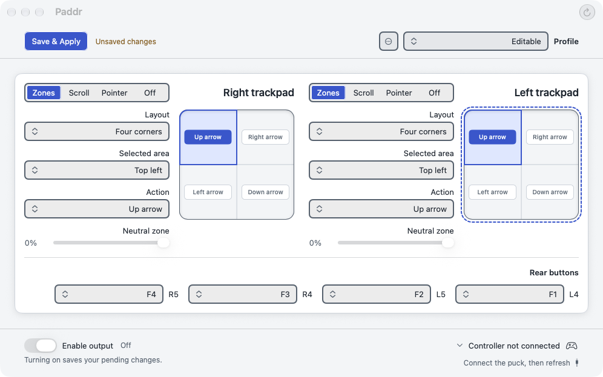
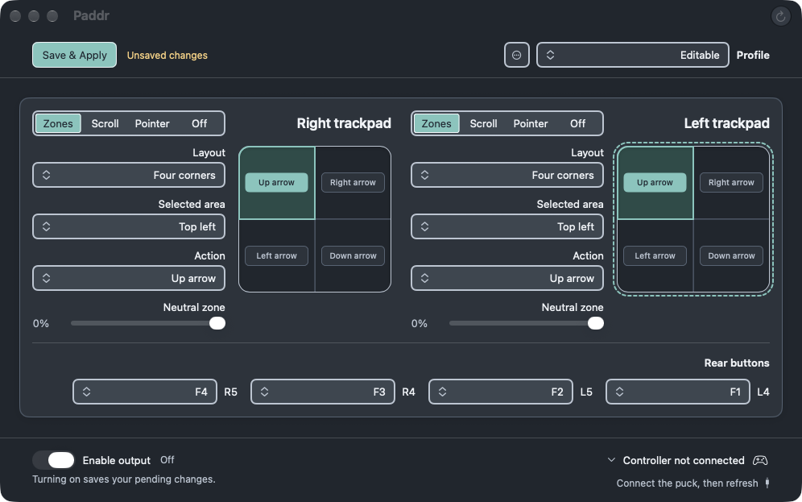
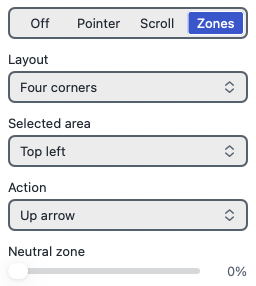
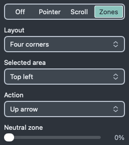
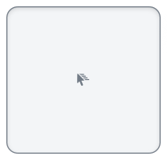
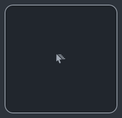
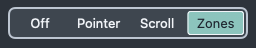

# Bespoke control comparison

The after images are **WindowServer-composited native window captures** of the
existing inert in-memory fixture with system access granted. They include native
Liquid Glass, which cached AppKit display alone omits. They are fixture evidence;
live README screenshots and published-release before images remain unchanged.
No personal profile, receiver or production app was opened.

Before: published 1.1.0 at `d0c99d8`, preserved with its original cached-render
provenance. After: this shared-edge/pad-surround/inset-glass candidate based on
`6b0551fe246a5be3ec12658e5a30e341653669fd` (PR #96). Mode controls, menu variants
and numerical-row edges now share 240 points; maps retain 190 × 182. Modes have
4-point track inset, 2-point gaps and actual blue/teal selected native glass.
Circular pad arcs and the exterior-cast recess remove the reported corner seam
without thickening the rim. Profile/rear menus share the width; rear pairs wrap.

macOS 27.2 / 26B118, SDK 27.0, Swift 6.4, arm64, deployment 26.0. The exporter
captures only its own fixture window using existing Screen Recording access,
without requesting permission or changing global settings. Native screenshots use
the host's reported 1x output without resizing. Separate cached 1x/2x opaque-pad
and control rasters test geometry, not physical Retina rendering.

| Appearance | Before | After |
| --- | --- | --- |
| Light |  |  |
| Dark |  |  |

The user's both-Zones scenario retains four corners and zero neutral radius:

| Light | Dark |
| --- | --- |
|  |  |
|  |  |

Direct crops preserve native pixels. Contact-sheet crops use nearest sampling:

| Detail | Light | Dark |
| --- | --- | --- |
| Shared menu/readout edges |  |  |
| Pointer pad surround |  |  |
| Inset selected glass |  |  |
| Concentric pad focus |  |  |
| Open setup rim (targeted missing-access fixture only) |  |  |

Full captures: `/tmp/paddr-refinement-8a0553bb/final-validated/`. Canonical test log:
`/tmp/paddr-refinement-8a0553bb/tests-final.log` (**532 tests, 531 passed, one
existing map-focus skip**). Native selected-glass contrast samples exceed 6.5:1.
The same-mounted tests cover both edges and numerical columns, both sides/modes,
RTL, constrained widths and accessibility text. Native accessibility5 top/lower
captures are in the full directory; their screen-capped scrolling content is
verified from composition because cached mixed-glass renders omit layers. The exact local commit and clean
ad-hoc package identity are recorded in `/tmp/paddr-refinement-8a0553bb/HANDOFF.md`.

See [the validation record](../PADDR_BESPOKE_CONTROLS_VALIDATION.md) for commands,
failed-before regressions, capture provenance and all remaining gaps. The source
`6b0551f` had a clean external Codex review after its prior Sol tuning-switch RTL
finding was repaired. Fresh Sol review at `e83a0c3` found one minor stale-hover issue
during mode dragging, repaired with a failing-before/passing-after event regression;
current-head external review remains separate. Full assistive-technology,
live hardware, inactive pointer feel, physical Retina and macOS 26 runtime checks
remain unverified. The key-window-dependent SwiftUI map focus test remains skipped
with its assertions intact; the earlier reconnect-pressure timeout remains unexplained.
