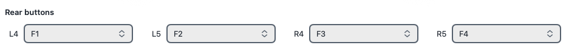
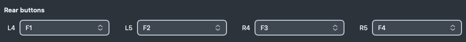
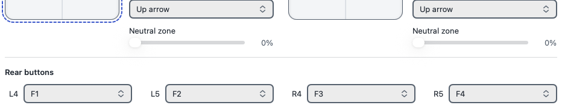
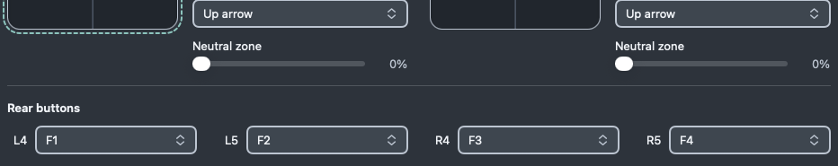

# Bespoke control comparison

After images are **WindowServer-composited inert fixture windows**, with system
access granted and existing Screen Recording permission. They include the retained
secondary/menu/track glass. Selected modes and Save & Apply are now **flat** light
blue / dark Compass teal with fine pale edges. Native captures use the host's
reported 1x output. Cached 1x/2x rasters establish geometry, not physical Retina proof.
No production app, personal profile or receiver was opened; no TCC/global settings
changed. Live README screenshots and original published-release before images remain
untouched.

The current rear-alignment candidate starts at `fba3255d071e5278572faea76cd8cdbb9232eb67`
(PR #96). The newest direction retains flat accents and refines the default rear row:

- 996-point preferred usable window, derived from two 190 + 16 + 240-point editors,
  their 24-point separation and existing card/window insets.
- 16-point pad/options gutter, yielding only to 8–16 at the constrained inline threshold.
  Mode/menu/readout edges still align; sensor maps remain 190 × 182.
- One default rear row in L4, L5, R4, R5 order, with equal 180-point selectors.
  L5/R5 share their pad inspector trailing edges; all three adjacent menu gaps match.
  Shared bounded pad-column geometry controls placement, including constrained dual
  widths. If those anchors cannot fit a single equal-stride row (also possible in
  wider hosts), whole code/menu pairs wrap. Stacked/accessibility layouts wrap too;
  logical RTL order and native identity remain.
- Flat selected/action fills, 4-point segment inset, 2-point gaps, local feedback,
  distinct focus and opaque accessibility fallbacks. Secondary glass remains native.

| Appearance | Published 1.1.0 before | Current candidate |
| --- | --- | --- |
| Light |  |  |
| Dark |  |  |

| Surface | Light | Dark |
| --- | --- | --- |
| Both Zones |  |  |
| Rear row |  |  |
| Above/rear alignment |  |  |
| Flat inset selection |  |  |
| Flat Save & Apply |  |  |
| Mirrored layout |  |  |
| Inspector edges |  |  |
| Pointer surround |  |  |
| Separate pad focus |  |  |

Full current captures and canonical receipts: `/tmp/paddr-rear-d2fa8221/`.
Direct crops preserve native pixels. The contact sheet compares default opening,
close rear alignment, constrained dual (984-point window / 904-point workspace),
wide fallback (1280 / 1200), RTL, narrow lower, accessibility lower, long raw rear
values at 180 points, and opaque fallbacks in both appearances. Full composited
captures are in `final/`; `contact-sheet.swift` retains the crop/sheet recipe.
`readme-narrow-{top,lower}-*` uses a 680-point fixture;
`readme-accessibility-{top,lower}-*` exercises accessibility5 and screen-capped scrolling.
`readme-both-zones-opaque-*` combines Increased Contrast, Reduce Transparency and
Reduce Motion. The live README images and published-release before captures stay
unchanged. Earlier flat-accent evidence remains `/tmp/paddr-flat-535f91b9/` and
`/tmp/paddr-flat-final-evidence/`.

The older `setup-rim-*.png` captures are retained from the preceding shared-edge
candidate because this secondary control is unchanged. They are not new-candidate
capture evidence. Before images retain their original cached-release provenance.
See [the current validation record](../PADDR_BESPOKE_CONTROLS_VALIDATION.md) for
commands, failures/reruns, source/settings receipts, limits and manual follow-up.
The earlier Sol review at `3e95637` found no actionable interface regression;
fresh independent review of this rear-alignment candidate remains pending. Its
pre-existing pressure-fixture finding is repaired with a deterministic regression;
see the validation record for scope and receipts. Full manual accessibility/keyboard,
hardware/output/disconnect, inactive pointer feel, physical Retina and macOS 26
runtime proof remain unverified. The map-focus key-window skip remains, and the
earlier reconnect-timeout receipt is retained without claiming its precise ordering
was reconstructed by the fixture repair.
