# Bespoke control comparison

The after images are **WindowServer-composited native window captures** of the
existing inert in-memory configuration fixture, with system access granted. They
include SwiftUI's native Liquid Glass pass, which cached AppKit renders omit.
They are fixture evidence, not hardware captures or replacements for live README
screenshots. No personal profile, receiver or production app was opened.

Before: `d0c99d8` (published 1.1.0), preserved unchanged with its original cached-render
provenance. The after files include the composited native material pass. After: the alignment/rim/depth refinement
introduced by this commit, based directly on `ef6e53fcdb926297f4cee4d7a24b88a54b7d0f5f`
(the preceding teal/glass refinement of PR #96). The same overview fixture uses
content-driven window sizing in light/dark. The dark accent is Compass North
`#78C7BD` from `Assets/AppIcon.icon/Assets/North.svg`; light keeps `#2859CF`.

Captured on macOS 27.2 (`26B118`), SDK 27.0, Swift 6.4, arm64. The existing
`FamilyConsoleLayoutEvidenceTests` exporter captures its own fixture window with
macOS 26 ScreenCaptureKit screenshots only when Screen Recording is already granted.
It does not request permission. Fixture-window animation is disabled to capture
settled native pixels, with no requested output resizing; the final window captures
are 1080 pixels wide at this host's reported 1x scale. Separate opaque stroke
fixtures exercise explicit 1x/2x cached raster scales; they do not claim physical
Retina verification. Regular glass and the tinted clear-glass primary action are
inspected in the composited captures.

| Appearance | Before | After |
| --- | --- | --- |
| Light | 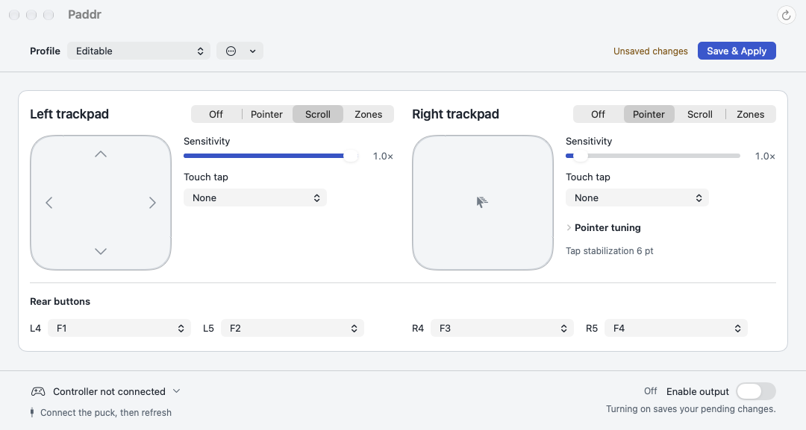 | 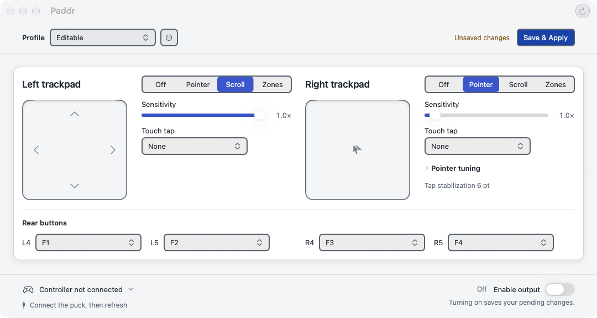 |
| Dark | 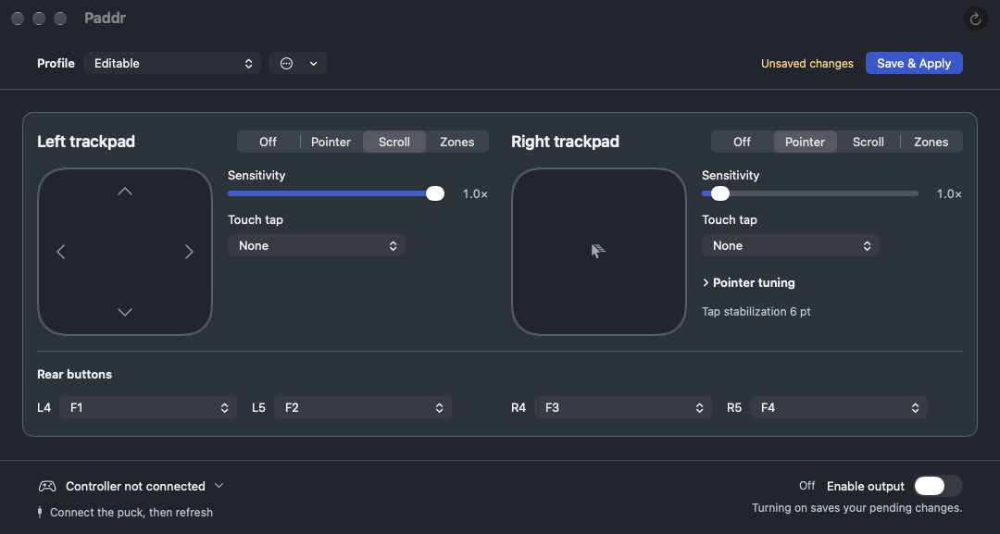 | 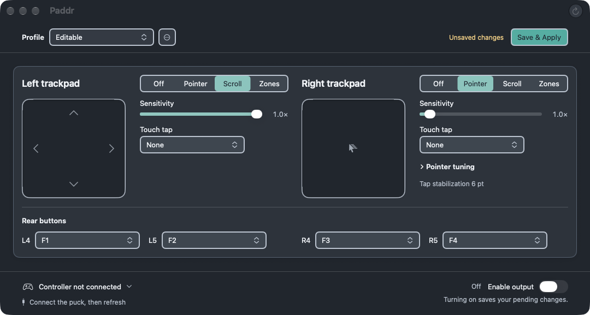 |

The user's both-Zones scenario, with four corners and zero neutral radius:

| Light | Dark |
| --- | --- |
| 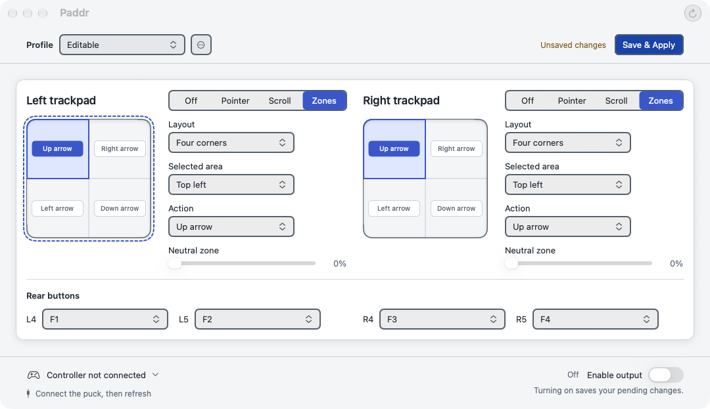 | 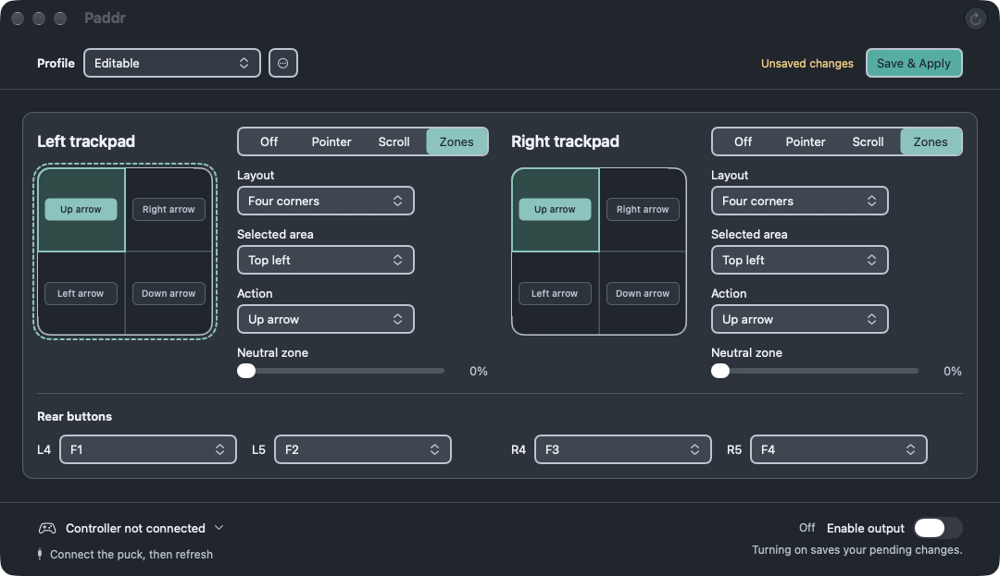 |

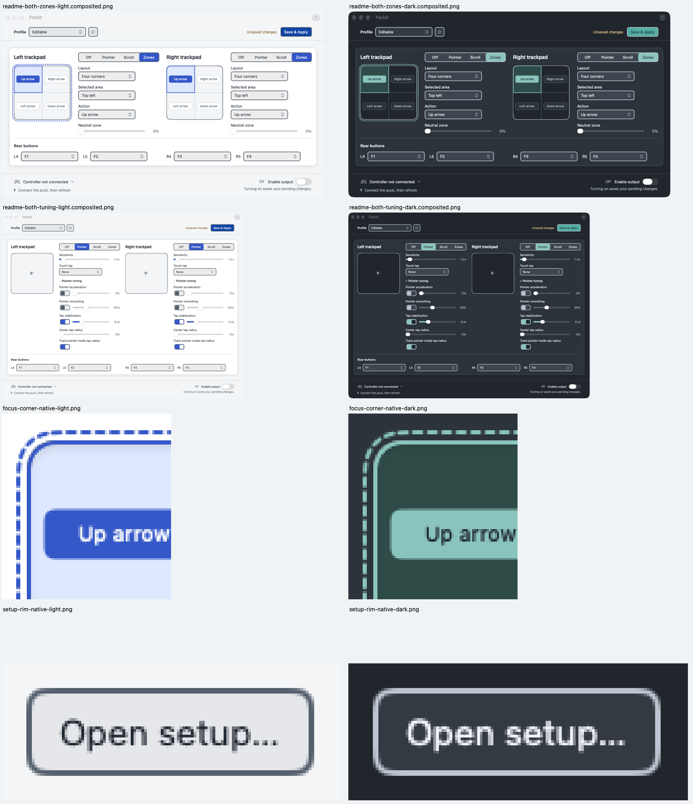

The native 1x crops are also available directly; the contact sheet enlarges them
without smoothing so individual pixels can be inspected:

| Detail | Light | Dark |
| --- | --- | --- |
| Concentric pad focus | 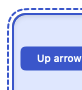 | 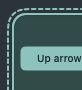 |
| Open setup rim | 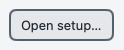 | 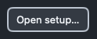 |

Full captures: `/tmp/paddr-layer-eeff8259/final/`. Final canonical test log:
`/tmp/paddr-layer-eeff8259-tests-complete.log`. The local handoff records the final
commit and exact-head package identity. Earlier `iteration-*` and `failed-final` directories are
experiments; they are not acceptance evidence.

See [the validation record](../PADDR_BESPOKE_CONTROLS_VALIDATION.md) for commands,
source/rendered coverage and remaining manual gaps. Prior independent reviews
predate this new refinement; fresh review remains the parent's responsibility.
